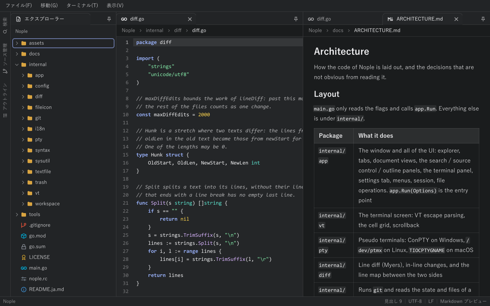
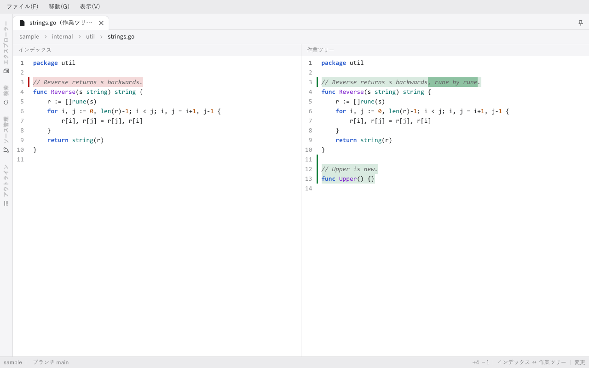
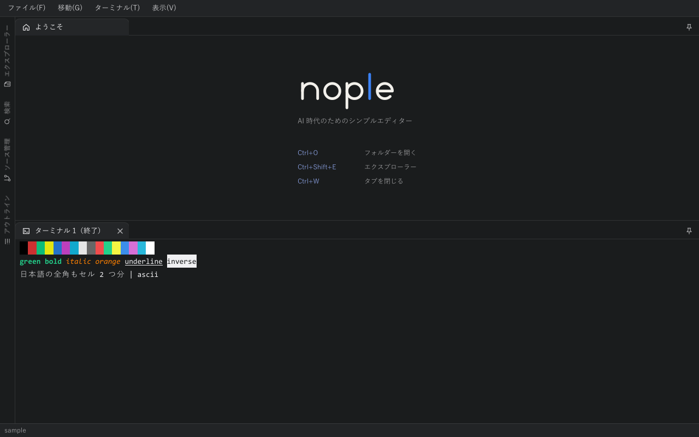
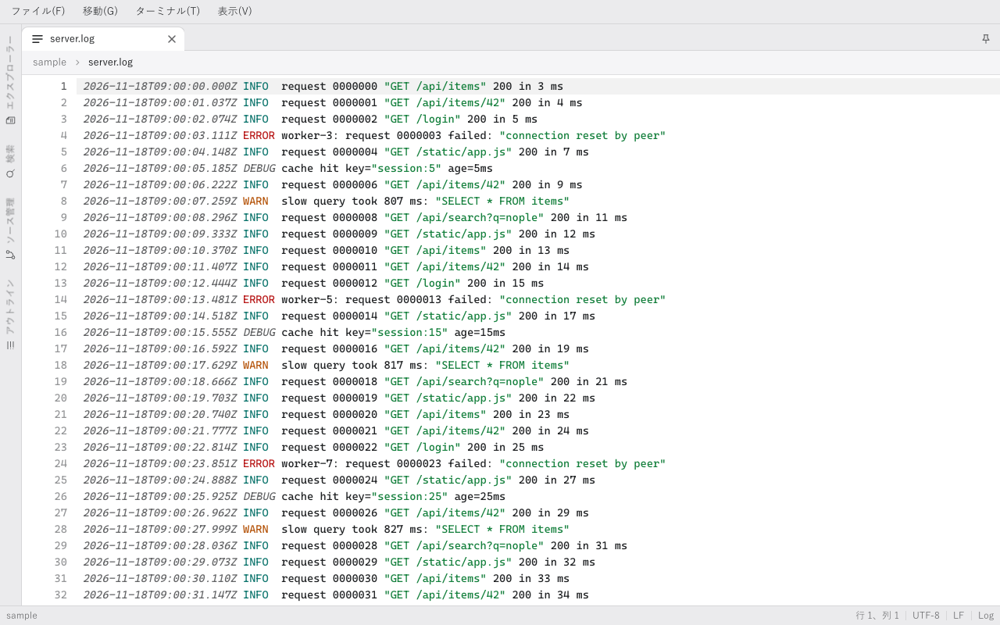

<h1 align="center">
  <picture>
    <source media="(prefers-color-scheme: dark)" srcset="assets/logo-dark.svg">
    
  </picture>
</h1>

<p align="center"><strong>AI 時代のためのシンプルエディター。</strong></p>

<p align="center"><a href="README.md">English</a></p>

コードを書くのは AI が担うようになり、人の仕事は、書かれたコードを**読んで確かめる**ことへ移りつつあります。Nople はそのためのエディターです。

起動はおよそ 0.1 秒です。フォルダを開けば、ファイルのツリーとタブ、色付きのコード、描画されたマークダウン、Git の差分、ターミナルがすぐに使えます。拡張機能を探したり、設定を整えたりする必要はありません。読んでいて手直しが要れば、その場で書き換えられます。開いたまま何もしていないあいだは、CPU をほとんど使いません。



## 開いて、すぐ読む

エクスプローラーには、`.git` を除いてフォルダのファイルがすべて出ます。設定の「**.gitignore に従う**」をオンにすれば、ビルドの成果物や依存のフォルダを、エクスプローラーとクイックオープン、検索から外せます。ファイルはシングルクリックでプレビューのタブに開き、残したいものだけをダブルクリックで固定できます。コードは [chroma](https://github.com/alecthomas/chroma) で数百の言語を色分けします。マークダウンは描画した状態で開き、アウトラインから見出しへ飛べます（`Ctrl+Shift+V` でソースに切り替え）。画像と SVG は画像として表示します。

探すときは、ファイル名で開くクイックオープン（`Ctrl+P`）、行へ移動（`Ctrl+G`）、コマンドパレット（`Ctrl+Shift+P`）、正規表現も使える全文検索があります。タブを右に分割すれば、同じファイルの離れた 2 か所を並べて読めます。

## 変更を確かめる

ソース管理のパネルには、変更のあるファイルがステージ済みと未ステージに分かれて並びます。開くと差分が左右に並び、スクロールは両側で連動します。エディターでも、変更のある行には行番号の横に色の帯が付きます。

Git は読むだけです。ステージもコミットもしません。git を任意のロックなしで動かすので、`git status` でさえロックファイルを残さず、ターミナルで git を操作している最中でもぶつかりません。

内蔵のターミナルは、24bit カラー、vim や less のような全画面のプログラム、IME に対応しています。テストやビルドの出力に出た `ファイル:行` は、`Ctrl+クリック` でその行を開けます。

| 差分 | ターミナル |
|---|---|
|  |  |

## 大きなファイルとログ

8 MB を超えるファイルは、全体を読み込むのを待たずに開きます。手元の計測では、1 GB のログで約 6 ms、10 GB でも 7 ms 足らずで表示を始められる状態になりました。残りは裏で読み進めるので、そのあいだもスクロールやファイル内の検索、書き換えができます（保存は読み終えてからです）。

`.log` のファイルは、時刻と DEBUG を薄く、ERROR・WARN・INFO をそれぞれの色で表示します。大きなログは、ほかのプログラムが行を書き足すと、その分だけ伸びていきます。



大きなファイルでは、表示している行の分だけを裏で色分けするので、どこへ飛んでも色付けを待たされることはありません。Git の変更の色帯とアウトラインは、ファイル全体を読む必要があるため出しません。

### 数字について

この README の数字は、Core i7-12700H と NVMe SSD を積んだ Windows 11 のノート PC で測った中央値です。

- 起動は 20 回測りました。温まった状態の数字で、再起動の直後は測っていません。
- 待機中の CPU は、フォルダやファイルを開いたまま 5 秒ずつ 3 回測り、どれも 0 ms でした。
- 大きなファイルは 5 回ずつ、WSL 2 の Linux で、各回の前にファイルのキャッシュを捨てて測りました（Windows 側が持つ仮想ディスクのキャッシュは残ります）。時間は、先頭の 1 MB を読んで表示できるようになるまでです。

同じ PC で、ファイルが OS のキャッシュに載った状態で、VS Code と Zed とも比べました。1 GB のログを引数に渡して起動し、中身がウィンドウに出るまでは、Nople が 0.31 秒、VS Code が 8.0 秒、Zed が 2.1 秒でした。10 GB では、Zed は開けませんでした。

測った条件と手順、キャッシュに載った状態の数字、ほかのエディターとの比較の詳細は [docs/PERFORMANCE.ja.md](docs/PERFORMANCE.ja.md) にまとめてあり、同じ手順で測り直せます。

## ファイルを元のまま扱う

UTF-8（BOM の有無）、Shift_JIS と、改行の LF・CRLF を判定し、読んだときと同じ形で保存します。保存は同じフォルダの一時ファイルに書いてから差し替えるので、途中でアプリが落ちても、元のファイルが中途半端に書かれた状態で残ることはありません。

ほかのアプリがファイルを書き換えたら、読み直します。こちらに未保存の変更があるときは知らせて、どうするかを選べます。大きなファイルでは、できる限り変更を新しい内容の中に置き直します。終了するときには、フォルダ、タブ、配置、スクロール位置を覚えておき、次に起動したときに戻します。

## 入れないもの

拡張機能、デバッグ、サインイン、AI 機能、LSP（定義へ移動、ホバー）、Git の書き込み（ステージ、コミット、プッシュ、ブランチの切り替え）、折りたたみ、ミニマップは入れていません。読んで確かめるのに要るものだけを持つ、というのが Nople の考え方です。

## インストール

Nople は Go 製で、cgo を使いません。開発は主に Windows で行っていますが、同じコードが Linux と macOS でも動きます。

| OS | ファイル | 入れ方 |
|---|---|---|
| Windows | `nople-<版>-windows-x64-setup.exe` | 実行する。管理者の権限は要らず、`%LOCALAPPDATA%\Programs\Nople` に入る（最初の画面で全ユーザー向けも選べる）。エクスプローラーの「Nople で開く」と「プログラムから開く」、PATH への追加は途中で選べる |
| Debian / Ubuntu | `nople_<版>_amd64.deb` | `sudo apt install ./nople_<版>_amd64.deb` |
| そのほかの Linux | `nople-<版>-linux-x64.tar.gz` | 展開して `./install.sh`（`~/.local` に入る。全ユーザー向けは `sudo ./install.sh --system`）。`./uninstall.sh` で削除できる |
| macOS | `nople-<版>-macos-setup.pkg` | 開いてインストーラーに従う。`/Applications` に `Nople.app` が入り、`/usr/local/bin/nople` からリンクされる。Apple シリコンの macOS 12 以降で動く（Intel 向けはまだない） |

Linux ではファイルマネージャーの「アプリケーションで開く」に、フォルダとテキストのファイル向けに Nople が出ます。描画に Vulkan を使うので、Vulkan のドライバー（Mesa など）が要ります。macOS のパッケージはまだ Developer ID で署名していないので、ダウンロードしたものは Gatekeeper に止められます。一度開こうとしたあと、システム設定の「プライバシーとセキュリティ」にある「このまま開く」で許可してください。Finder の「このアプリケーションで開く」には、フォルダと、Nople が開くテキストやソースのファイル向けに Nople が出ます。

## 使い方

```bash
nople [フォルダ|ファイル]
```

フォルダを指定しなければ、前回開いていたものを開きます。ファイルを指定すると、前回のセッションを戻したうえで、そのファイルを新しいタブで開きます。

| フラグ | 意味 |
|---|---|
| `-fresh` | 何も開かずに起動し、セッションを保存しない |
| `-shell "cmd.exe"` | 新しいターミナルのシェル（環境変数 `NOPLE_SHELL` でも可） |
| `-quit-after 5s` | 指定の時間で自動的に終了する |
| `-register` | エクスプローラーに「Nople で開く」を足し、テキストやソースのファイルを開くアプリの候補に Nople を載せる（Windows） |
| `-unregister` | `-register` で足したものを取り除く |
| `-version` | 版を表示して終了する |

### エクスプローラーから開く（Windows）

インストーラーで選ばなかったときや、exe を自分で置いたときは、次のコマンドで登録できます。

```bash
nople -register
```

今のユーザーのレジストリ（`HKEY_CURRENT_USER`）にだけ書くので、管理者の権限は要りません。登録するのは実行した `nople.exe` の場所なので、exe を使う場所に置いてから実行し、移動したらもう一度実行してください。

- フォルダ、フォルダの中の余白、ドライブ、ファイルの右クリックに「Nople で開く」が出ます。
- `.go`、`.md`、`.json` などを「プログラムから開く」で選べるようになります。Windows はアプリが自分で既定のアプリになることを許さないので、既定にするには「設定 → アプリ → 既定のアプリ → Nople」か、「プログラムから開く → 常にこのアプリを使う」で選びます。

### キーボードショートカット

| キー | 動作 |
|---|---|
| `Ctrl+O` | フォルダを開く |
| `Ctrl+P` | ファイルへ移動 |
| `Ctrl+G` | 行へ移動 |
| `Ctrl+Shift+P` | コマンドパレット |
| `Ctrl+Shift+E` / `F` / `G` / `O` | エクスプローラー／検索／ソース管理／アウトライン |
| `Ctrl+Shift+V` | 描画とソースの切り替え（マークダウン、SVG） |
| `Ctrl+\` | 右に分割 |
| `Ctrl+W` / `Ctrl+Tab` | タブを閉じる／次のタブ |
| `Ctrl+N` | 新しいファイル |
| `Ctrl+S` | 保存 |
| `Ctrl+J`（または `Ctrl+@`） | ターミナルの表示／非表示 |
| `Alt+Z` | 折り返し |
| `Ctrl+=` / `Ctrl+-` / `Ctrl+0` | 拡大／縮小／元の大きさ |
| `Ctrl+,` | 設定 |
| `F2` / `Delete` | エクスプローラーで名前の変更／削除 |

### 設定

`Ctrl+,` で設定のタブが開きます。設定はすべて JSON 1 枚に収まっていて、手で直すこともできます（**ファイル → 設定を JSON で開く**）。保存するとすぐに効きます。

- Windows: `%APPDATA%\Nople\settings.json`
- macOS: `~/Library/Application Support/Nople/settings.json`
- Linux: `~/.config/Nople/settings.json`

```json
{
	"fontFamily": "Consolas",
	"fontSize": 14,
	"theme": "system",
	"wrap": false,
	"shell": "",
	"language": "system",
	"autosave": "afterDelay",
	"autosaveDelay": 1000,
	"gitignore": false
}
```

| キー | 値 |
|---|---|
| `theme` | `system`、`light`、`dark` |
| `shell` | 新しいターミナルのコマンドライン。空なら、Windows では PowerShell 7、無ければ Windows PowerShell、ほかでは `$SHELL` |
| `language` | `system`、`en`、`ja`。UI の言語は JSON を 1 つ足せば増やせる（[手順](internal/i18n/locales/README.md)） |
| `autosave` | `afterDelay`（打ち終えて `autosaveDelay` ミリ秒）、`onFocusChange`、`off`。`off` のときは、未保存のファイルを閉じる前に確認する |
| `gitignore` | `true` なら、`.gitignore` で無視されたものをエクスプローラーとクイックオープン、検索に出さない。`false`（既定）ならすべて出す。`.git` はどちらでも隠す |

セッション（開いているフォルダ、タブ、配置、スクロール位置）は同じ場所の `session.json` に保存します。

## ビルド

Go 1.27 以上が要ります。

Nople は Go の GPU ネイティブな UI ライブラリ [gowaku](https://github.com/bankai-tensei/gowaku) で作っています。`go.mod` に gowaku の版を書いてあるので、`go build` が取ってきます。

```bash
git clone https://github.com/bankai-tensei/nople Nople
```

```bash
cd Nople && go build -ldflags="-H windowsgui" .
```

`-ldflags="-H windowsgui"` は Windows でコンソールのウィンドウを出さないためのもので、ほかの OS では要りません。`nople.exe` のアイコンは、リポジトリにある `rsrc_windows_amd64.syso` から取り込まれます。`assets/icon.ico` を変えたら `go generate` で作り直します（MinGW か TDM-GCC の `windres` が要ります）。

gowaku と一緒に手を入れるときは、gowaku を Nople の隣に clone し、Nople に `go.work` を作ります（git には入りません）。

```bash
git clone https://github.com/bankai-tensei/gowaku ../gowaku
```

```bash
go work init . ../gowaku ../gowaku/markdown
```

新しい gowaku に移るときは、両方のモジュールにその版を指定します。

```bash
go get github.com/bankai-tensei/gowaku@<版> github.com/bankai-tensei/gowaku/markdown@<版>
```

### インストーラーを作る

出来上がりは `dist/` に置かれます。Windows 版には [Inno Setup 6](https://jrsoftware.org/isinfo.php) が要ります（`winget install JRSoftware.InnoSetup`）。

```bash
pwsh packaging/windows/build.ps1 -Version 0.1.0
```

Linux 版には `dpkg-deb` と `fakeroot` が要り、Go があれば先にビルドもします。

```bash
packaging/linux/build.sh 0.1.0
```

Windows からは、Linux 向けにビルドしてから、WSL でパッケージにします。

```bash
CGO_ENABLED=0 GOOS=linux go build -trimpath -ldflags "-s -w -X main.version=0.1.0" -o dist/linux/nople .
```

```bash
wsl sh packaging/linux/build.sh 0.1.0
```

macOS 版は、Go と macOS に付いてくるツールで、Mac の上で作ります。Apple シリコン向けの `dist/macos/Nople.app` と、それを入れるパッケージができます。`SIGN_APP` と `SIGN_PKG` を渡すと Developer ID で署名します（スクリプトの冒頭を参照）。

```bash
packaging/macos/build.sh 0.1.0
```

## 開発

```bash
go test ./...
```

テストはウィンドウを出さずに UI 全体を動かします。`NOPLE_SHOTS=1` を付けると `docs/shots/` にスクリーンショットを書きます。

コードの構成は [docs/ARCHITECTURE.md](docs/ARCHITECTURE.md)（英語）に、速さの測り方は [docs/PERFORMANCE.ja.md](docs/PERFORMANCE.ja.md) にあります。変更を送るときは [CONTRIBUTING.ja.md](CONTRIBUTING.ja.md) を、リリースごとの変更は [CHANGELOG.md](CHANGELOG.md)（英語）を見てください。

## ライセンス

[MIT](LICENSE)。

ソースファイルのアイコンは Jesse Weed の [Seti UI](https://github.com/jesseweed/seti-ui)（MIT ライセンス）に基づきます。[assets/seti/LICENSE.txt](assets/seti/LICENSE.txt) を参照してください。Nople が使っているライブラリは [THIRD_PARTY_NOTICES.md](THIRD_PARTY_NOTICES.md) にまとめてあります。
