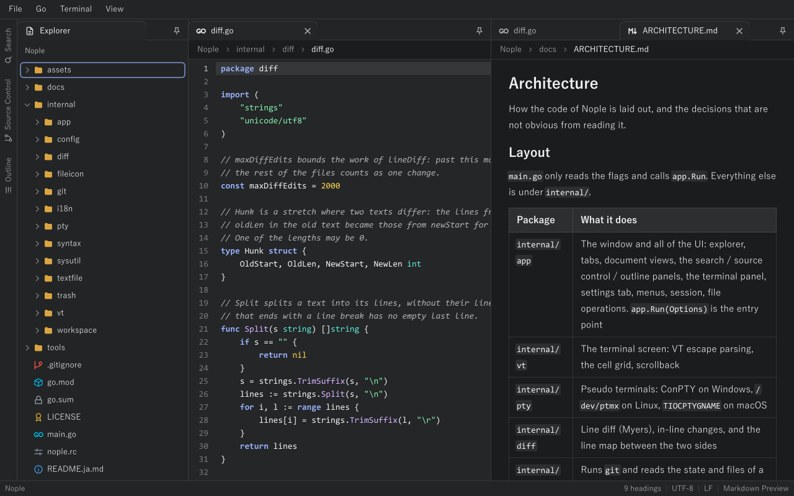
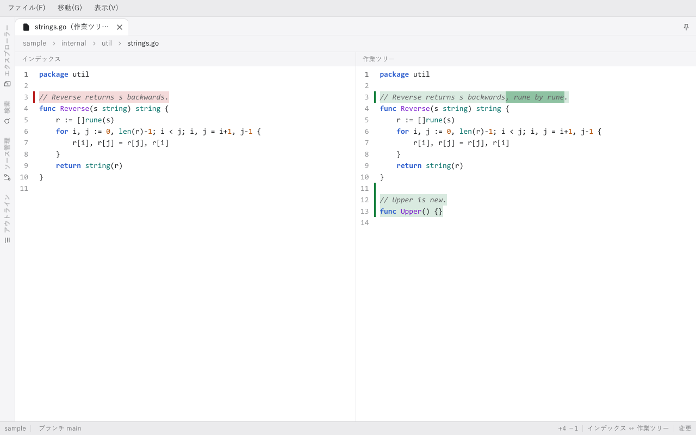
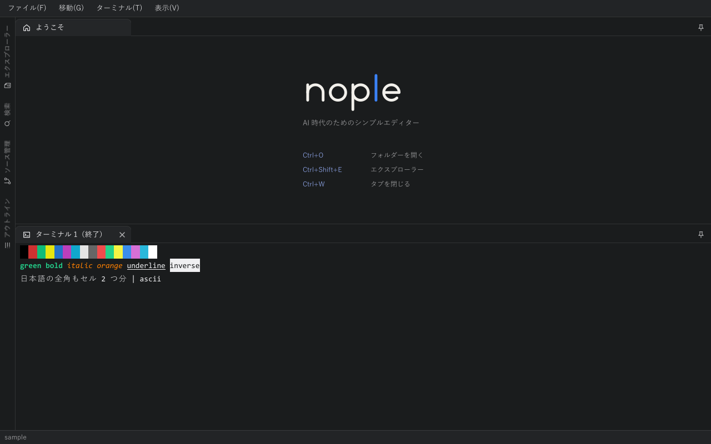
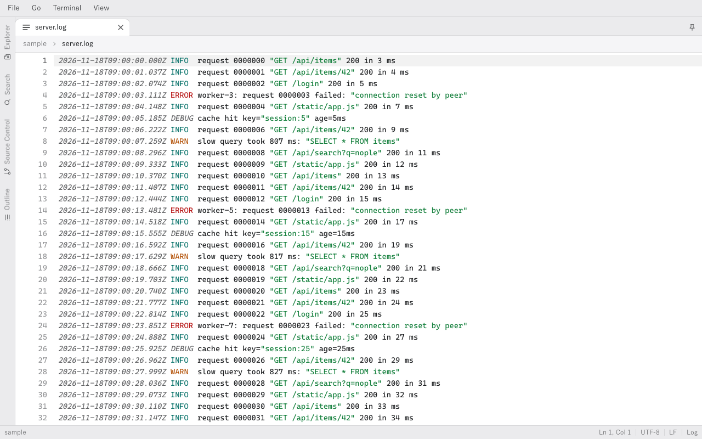

<h1 align="center">
  <picture>
    <source media="(prefers-color-scheme: dark)" srcset="assets/logo-dark.svg">
    
  </picture>
</h1>

<p align="center"><strong>A simple editor for the age of AI.</strong></p>

<p align="center"><a href="README.ja.md">日本語</a></p>

AI writes more and more of the code; the human's job is shifting to *reading* it and making sure it is right. Nople is an editor built for that.

It starts in about a tenth of a second. Open a folder and you get a file tree and tabs, highlighted code, rendered Markdown, Git diffs and a terminal, with no extensions to hunt for and no settings to tune. When something you are reading needs a touch-up, you edit it right there. Left open with nothing going on, it uses next to no CPU.



## Open it and read

The explorer shows every file in the folder except `.git`. Turn on **Follow .gitignore** in the settings, and build output and dependency folders stay out of the explorer, quick open and search. A single click opens a file in a preview tab; double-click the ones you want to keep. Code is highlighted by [chroma](https://github.com/alecthomas/chroma) for hundreds of languages. Markdown opens rendered, with an outline that jumps to its headings (`Ctrl+Shift+V` shows the source), and images and SVG open as images.

To find your way around, there is quick open by file name (`Ctrl+P`), go to line (`Ctrl+G`), a command palette (`Ctrl+Shift+P`), and full-text search with regular expressions. Split a tab to the right to read two parts of the same file side by side.

## Check what changed

The source control panel lists the changed files, staged and unstaged. Open one to see a side-by-side diff whose two sides scroll together. The editor also marks changed lines with a bar in the gutter.

Git is read-only: Nople never stages or commits. It runs git without its optional locks, so even `git status` leaves no lock file behind and never gets in the way of the git you run in the terminal.

The built-in terminal handles 24-bit color, full-screen programs like vim and less, and IME input. Ctrl+click a `file:line` in test or build output to jump to it.

| Diff | Terminal |
|---|---|
|  |  |

## Large files and logs

Files over 8 MB open without waiting for the whole file to be read. On our test machine, a 1 GB log was ready to show in about 6 ms, and a 10 GB one in under 7 ms. The rest is read in the background, and you can scroll, search within the file and edit meanwhile (saving waits until it has been read).

In `.log` files, times and DEBUG are dimmed, and ERROR, WARN and INFO each get a color. A large log grows as another program appends to it.



In a large file, only the lines in view are colored, in the background, so a jump anywhere never waits for the colors. Large files show no Git change bars or outline, since both need the whole file.

### About the numbers

The numbers in this README are medians measured on a Windows 11 laptop with a Core i7-12700H and an NVMe SSD.

- Starts were measured 20 times, warm; a start just after a reboot was not measured.
- Idle CPU was measured over three 5-second stretches with a folder or a file open, and was 0 ms each time.
- Large files were opened 5 times each on Linux in WSL 2, with the file cache dropped before each open (what Windows caches of WSL's virtual disk stays). The time is until the first 1 MB is read and the file can be shown.

Nople was also measured against VS Code and Zed on the same machine, with the files in the cache of the OS. Started with a 1 GB log as its argument, Nople showed its contents in 0.31 s, VS Code in 8.0 s and Zed in 2.1 s; Zed could not open a 10 GB log.

The conditions, the method, the numbers with a warm cache and the comparison in full are in [docs/PERFORMANCE.md](docs/PERFORMANCE.md), along with how to reproduce them.

## Encodings and reloads

Nople detects UTF-8 (with or without a BOM) and Shift_JIS, and LF or CRLF line endings, and saves each file back the way it found it. A save is written to a temporary file beside the original, which then takes its place, so a crash in the middle of a save never leaves a half-written file.

When another program changes a file, Nople reads it again. If you have unsaved edits, it tells you and lets you choose; in a large file, it places your edits in the new contents when it can. When you quit, Nople remembers the folder, tabs, layout and scroll positions, and brings them back next time.

## What Nople leaves out

Extensions, debugging, sign-in, AI features, LSP (go to definition, hover), Git writes (stage, commit, push, checkout), folding and the minimap. Nople includes only what reading and checking code needs.

## Install

Nople is written in Go, without cgo. It is developed mostly on Windows, and the same code runs on Linux and macOS.

| OS | File | How |
|---|---|---|
| Windows | `nople-<version>-windows-x64-setup.exe` | Run it. It needs no administrator rights and installs into `%LOCALAPPDATA%\Programs\Nople` (the first page also offers all users). "Open with Nople" in Explorer, "Open with", and PATH are options on the way |
| Debian / Ubuntu | `nople_<version>_amd64.deb` | `sudo apt install ./nople_<version>_amd64.deb` |
| Other Linux | `nople-<version>-linux-x64.tar.gz` | Unpack it and run `./install.sh` (into `~/.local`; `sudo ./install.sh --system` for all users). `./uninstall.sh` removes it |
| macOS | `nople-<version>-macos-setup.pkg` | Open it and follow the installer. It puts `Nople.app` into `/Applications` and links `/usr/local/bin/nople` to it. Runs on Apple silicon, macOS 12 or later; there is no Intel build yet |

On Linux, the file manager offers Nople in "Open With" for folders and text files. Nople draws with Vulkan, so it needs a Vulkan driver (such as Mesa). On macOS, the package is not signed with a Developer ID yet, so Gatekeeper holds a downloaded one; after the first try, allow it with Open Anyway in System Settings > Privacy & Security. Finder offers Nople in "Open With" for folders and the text and source files it opens.

## Usage

```bash
nople [folder|file]
```

With no folder, Nople opens what was open last time. Given a file, it restores the last session and opens the file in a new tab.

| Flag | Meaning |
|---|---|
| `-fresh` | Start with nothing open, and don't save the session |
| `-shell "cmd.exe"` | The shell of new terminals (also the `NOPLE_SHELL` environment variable) |
| `-quit-after 5s` | Quit on its own after this long |
| `-register` | Add "Open with Nople" to Explorer and list Nople among the programs that open text and source files (Windows) |
| `-unregister` | Remove what `-register` added |
| `-version` | Print the version and quit |

### Opening from Explorer (Windows)

If you did not choose it in the installer, or put the exe in place yourself, register it with:

```bash
nople -register
```

It writes only to the registry of the current user (`HKEY_CURRENT_USER`), so it needs no administrator rights. It registers the `nople.exe` you run, so put the exe where it will live first, and run it again after moving it.

- Right-clicking a folder, the empty space in a folder, a drive or a file shows "Open with Nople".
- `.go`, `.md`, `.json` and the like can be opened with Nople from "Open with". Windows does not let a program make itself the default, so to make Nople the default, pick it in Settings → Apps → Default apps → Nople, or in "Open with → Always use this app".

### Keyboard shortcuts

| Keys | Action |
|---|---|
| `Ctrl+O` | Open folder |
| `Ctrl+P` | Go to file |
| `Ctrl+G` | Go to line |
| `Ctrl+Shift+P` | Command palette |
| `Ctrl+Shift+E` / `F` / `G` / `O` | Explorer / Search / Source control / Outline |
| `Ctrl+Shift+V` | Toggle rendered view and source (Markdown, SVG) |
| `Ctrl+\` | Split right |
| `Ctrl+W` / `Ctrl+Tab` | Close tab / Next tab |
| `Ctrl+N` | New file |
| `Ctrl+S` | Save |
| `Ctrl+J` (or `Ctrl+@`) | Toggle terminal |
| `Alt+Z` | Word wrap |
| `Ctrl+=` / `Ctrl+-` / `Ctrl+0` | Zoom in / out / reset |
| `Ctrl+,` | Settings |
| `F2` / `Delete` | Rename / delete in the explorer |

### Settings

`Ctrl+,` opens the settings tab. All the settings live in one JSON file, which you can also edit by hand (**File → Open Settings (JSON)**); changes apply as soon as it is saved.

- Windows: `%APPDATA%\Nople\settings.json`
- macOS: `~/Library/Application Support/Nople/settings.json`
- Linux: `~/.config/Nople/settings.json`

```json
{
	"fontFamily": "Consolas",
	"fontSize": 14,
	"theme": "system",
	"wrap": false,
	"shell": "",
	"language": "system",
	"autosave": "afterDelay",
	"autosaveDelay": 1000,
	"gitignore": false
}
```

| Key | Values |
|---|---|
| `theme` | `system`, `light`, `dark` |
| `shell` | The command line of new terminals. Empty picks PowerShell 7, then Windows PowerShell on Windows, and `$SHELL` elsewhere |
| `language` | `system`, `en`, `ja`. `system` follows the OS, or the `NOPLE_LANG` environment variable when it is set. Adding a UI language is adding one JSON file ([how](internal/i18n/locales/README.md)) |
| `autosave` | `afterDelay` (`autosaveDelay` ms after you stop typing), `onFocusChange`, `off`. With `off`, Nople asks before closing unsaved files |
| `gitignore` | `true` leaves what `.gitignore` ignores out of the explorer, quick open and search. `false` (the default) shows everything. `.git` stays hidden either way |

The session (open folder, tabs, layout, scroll positions) is saved next to it as `session.json`.

## Build

You need Go 1.27 or later.

Nople is built on [gowaku](https://github.com/bankai-tensei/gowaku), a GPU-native UI library for Go. `go.mod` names a version of it, so `go build` fetches it.

```bash
git clone https://github.com/bankai-tensei/nople Nople
```

```bash
cd Nople && go build -ldflags="-H windowsgui" .
```

`-ldflags="-H windowsgui"` keeps a console window from opening on Windows; leave it out on other systems. The icon of `nople.exe` is linked in from the committed `rsrc_windows_amd64.syso`. To rebuild it after changing `assets/icon.ico`, run `go generate` (needs `windres` from MinGW or TDM-GCC).

You can also install it without cloning. On Windows, add the same `-ldflags`.

```bash
go install github.com/bankai-tensei/nople@latest
```

Nople uses no cgo, so it cross-compiles with `GOOS` and `GOARCH`. This builds the Windows one from Linux or macOS:

```bash
GOOS=windows GOARCH=amd64 go build -ldflags="-H windowsgui" .
```

To work on gowaku and Nople together, clone gowaku beside Nople and make a `go.work` in Nople (it is ignored by git):

```bash
git clone https://github.com/bankai-tensei/gowaku ../gowaku
```

```bash
go work init . ../gowaku ../gowaku/markdown
```

To move to a newer gowaku, name its version in both modules:

```bash
go get github.com/bankai-tensei/gowaku@<version> github.com/bankai-tensei/gowaku/markdown@<version>
```

### Building the installers

They go into `dist/`. The Windows one needs [Inno Setup 6](https://jrsoftware.org/isinfo.php) (`winget install JRSoftware.InnoSetup`).

```bash
pwsh packaging/windows/build.ps1 -Version 0.1.0
```

The Linux ones need `dpkg-deb` and `fakeroot`, and build Nople first if Go is installed.

```bash
packaging/linux/build.sh 0.1.0
```

From Windows, build for Linux, then package it in WSL.

```bash
CGO_ENABLED=0 GOOS=linux go build -trimpath -ldflags "-s -w -X main.version=0.1.0" -o dist/linux/nople .
```

```bash
wsl sh packaging/linux/build.sh 0.1.0
```

The macOS one is built on a Mac with Go and the tools that come with macOS. It makes `dist/macos/Nople.app` for Apple silicon, and the package that installs it. `SIGN_APP` and `SIGN_PKG` sign them with a Developer ID; see the top of the script.

```bash
packaging/macos/build.sh 0.1.0
```

## Development

```bash
go test ./...
```

The tests run the whole UI without a window. Set `NOPLE_SHOTS=1` to have them write screenshots to `docs/shots/`.

See [docs/ARCHITECTURE.md](docs/ARCHITECTURE.md) for how the code is laid out, and [docs/PERFORMANCE.md](docs/PERFORMANCE.md) for how its speed is measured. To send a change, see [CONTRIBUTING.md](CONTRIBUTING.md); what changed in each release is in [CHANGELOG.md](CHANGELOG.md).

## License

[MIT](LICENSE).

The source-file icons are derived from [Seti UI](https://github.com/jesseweed/seti-ui) by Jesse Weed, under the MIT License; see [assets/seti/LICENSE.txt](assets/seti/LICENSE.txt). The libraries Nople is built with are listed in [THIRD_PARTY_NOTICES.md](THIRD_PARTY_NOTICES.md).
